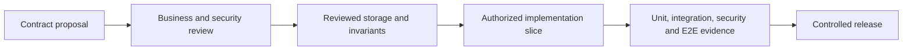

# Architecture decisions

Status distinguishes existing code from proposed implementation behavior. These
records summarize repository decisions; they do not approve unsettled business policy.

| ID      | Decision                                                                            | Status and consequence                                                                    |
| ------- | ----------------------------------------------------------------------------------- | ----------------------------------------------------------------------------------------- |
| ADR-001 | One Next.js modular monolith for all actor groups                                   | Established structure; no separate partner/admin backend                                  |
| ADR-002 | Strict TypeScript, src directory and @/* alias                                      | Configured; new aliases must update import enforcement                                    |
| ADR-003 | Inward feature dependencies and type-only public cross-module contracts             | Enforced by lint and architecture tests; runtime collaboration uses future injected ports |
| ADR-004 | Pure core/domain with no Next.js, Drizzle, provider or environment dependency       | Enforced; persistence records must map to domain contracts                                |
| ADR-005 | Node.js deployment with preserved Cache Components settings                         | Configured proposal; no edge DB adapters or route runtime overrides                       |
| ADR-006 | Global users, organization memberships and multi-store assignments                  | Proposed types/schema; no global partner role                                             |
| ADR-007 | Platform privileges separately granted with finite scope and sensitive controls     | Proposed contracts; no admin bypass, runtime verifier or grant storage                    |
| ADR-008 | Composite tenant/store FKs plus explicit authorization predicates                   | Schema declared; no RLS or working tenant query layer                                     |
| ADR-009 | Decimal-string money, UTC instants and store time zones                             | Proposed shapes/checks; two-decimal currencies and DST policy need acceptance             |
| ADR-010 | Narrow retirement conventions rather than universal soft deletion                   | Catalog deleted_at only; archive/disable/lifecycle for other entities                     |
| ADR-011 | Result failures with deliberate classification and fixed public errors              | Shared pure helpers exist; modules still need explicit error adapters                     |
| ADR-012 | Explicit-input environment parsing, no import-time connection                       | Zod validator exists; no bootstrap or activated capabilities                              |
| ADR-013 | Organization-row scheduling lock and atomic booking/outbox commit                   | Proposed correctness-first approach; no lock runner, reservation schema or DDL            |
| ADR-014 | Provider-neutral ports, stable idempotency, verified inbox and transactional outbox | Contracts only; no chosen provider or exactly-once promise                                |
| ADR-015 | Structured diagnostics separate from durable administrative audit                   | Ports only; redaction/retention/tamper resistance remain implementation gates             |
| ADR-016 | Built-in Node test runner plus tsx, offline schema metadata checks                  | Configured; no default live integration tests                                             |

Changing accepted structure requires updating its owner README, public contracts,
dependent tests and relevant diagrams together. Proposed policies need product,
security and operations agreement before becoming migration or handler behavior.
The final audit introduces documentation and offline tooling/tests only.
