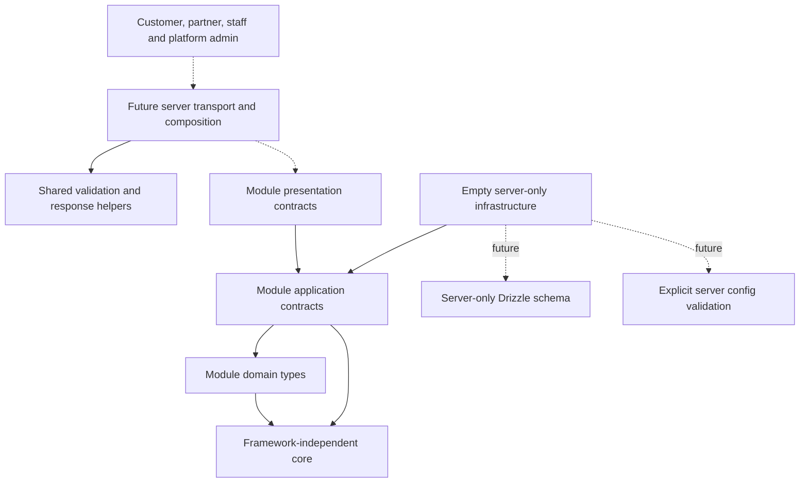

# Shared backend architecture

VelvetBook is a modular monolith in one Next.js deployment using the Node.js
runtime. src/modules contains 35 bounded-context directories plus _template.
These contain proposed entities, DTOs, ports, schemas and static policy data.
They do not contain running use cases, repositories or provider adapters.

| Directory          | Current responsibility                                                                                                                           |
| ------------------ | ------------------------------------------------------------------------------------------------------------------------------------------------ |
| src/app            | Starter UI; future server composition location                                                                                                   |
| src/modules        | Feature ownership and clean architecture contracts                                                                                               |
| src/core           | Pure errors/results, identifiers, authorization primitives, clock, money/time, logging, transaction, health, telemetry and integration contracts |
| src/shared         | Server validation/pagination and sanitized error mapping; response types                                                                         |
| src/infrastructure | Server-only empty entry point                                                                                                                    |
| src/db             | Server-only proposed schema declarations; no client                                                                                              |
| src/config         | Explicit-input Zod environment validator; no import-time process.env read                                                                        |
| src/types          | Reserved shared type directory                                                                                                                   |
| src/tests, tooling | Offline contract/schema tests, import enforcement and audit tooling                                                                              |

Dependencies point inward. Feature-to-feature dependencies are type-only public
application contracts. Infrastructure will implement ports, with consumer-owned
ports preventing runtime feature cycles. No generic base repository, service
locator, dependency container or fake adapter exists. Shared errors use Result;
legacy module errors need explicit classification at future transport boundaries.

Executable code currently consists of UI rendering, Zod validation/refinements,
configuration parsing, pagination schema creation, fixed error mapping and Drizzle
declaration callbacks. These are boundary/metadata helpers, not business services.
Static RBAC bundles are candidate permissions, not an authorization handler.

Future operations must apply transport bounds/validation, authenticate, resolve
trusted scope, verify ownership, authorize the exact action, execute a narrowly
scoped use case and produce sanitized responses/audit outcomes. Inject ports for
time, IDs, persistence, transactions and events. Tenant predicates must survive
list, export, aggregate and nested loads. A branded context is not runtime proof
without its future trusted verifier. See [security](security-and-tenancy.md).

See [dependencies](module-dependencies.md), [shared infrastructure](shared-backend-infrastructure.md),
[database](database-erd.md) and [testing](../testing-strategy.md). The roadmap
lists all completed contract modules and the gates before implementing behavior.
