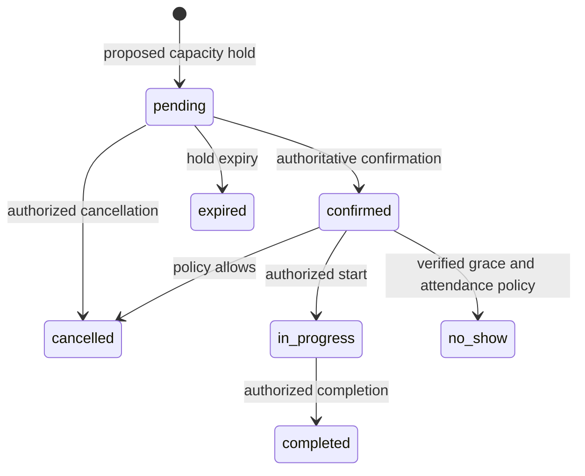
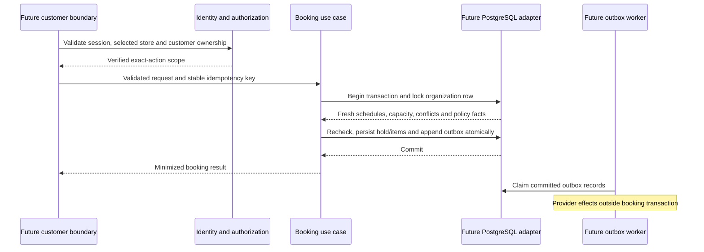

# Booking workflow proposal

The booking module defines entities/items, service staff assignments, policy
snapshots, revision/idempotency and lifecycle contracts. Availability has ports
for store hours, staff schedules/assignments, durations, capacity and conflicts.
Neither availability calculations nor lifecycle transitions run today.

The correctness-first concurrency proposal uses READ COMMITTED and a stable
organization-row lock before reading scheduling facts. All booking, reschedule,
expiry, staff/hours/capacity writers must follow the same discipline. Locking only
existing conflicts cannot protect an empty interval. Recheck current facts after
the lock and compare normalized fingerprints for the unique customer/key tuple.
Bounded deadlock retries rerun the entire database unit under the same key.

Half-open UTC ranges and canonical membership identity must prevent same-person
conflicts across stores within a tenant. Cross-organization staff conflicts remain
an open policy question. Availability results are advisory, not reservations.
Reschedule atomically validates replacement capacity while retaining the original
allocation until success. Cancellation/expiry/no-show require revision, state and
policy checks; time passing alone does not authorize a worker.

Current CHECK/FK/indexes do not enforce overlap, capacity, total reconciliation,
minimum one line, item containment, active memberships or state transitions. No
reservation table, GiST exclusion, migration, lock or transaction implementation
exists. Consider exclusion constraints only after capacity/assignment semantics
are settled; pooled capacity needs more than a single-resource exclusion.

Payments are separate state machines. Browser redirects are not confirmation;
late payment success after expiry needs explicit reconciliation/refund policy.
Provider calls, notifications and broker publication must never hold DB locks.
Use the shared transaction proof and existing outbox ports, then delivery with
stable event IDs and idempotent consumers. See the detailed
[concurrency proposal](customer-booking-modules.md) and [integration policies](external-integrations.md).
