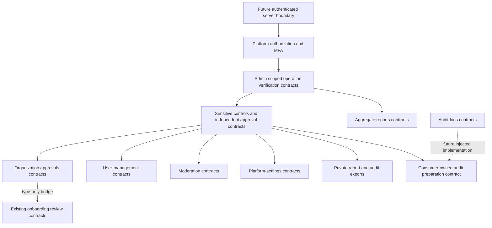
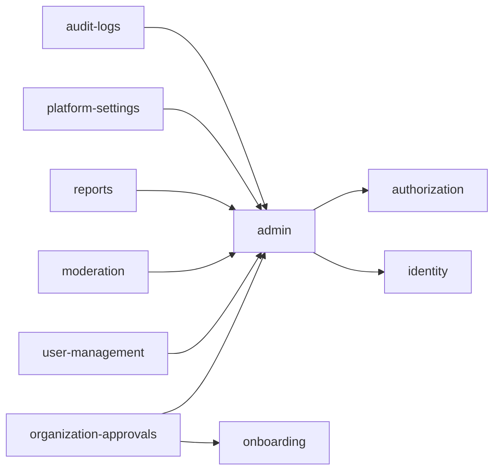

# Phase 8: centralized admin architecture

This phase defines proposed contracts, scoped permission data and input schemas.
No APIs, dashboard UI, database queries, admin operations, authorization engines,
context factories, grant provisioning or audit handlers are implemented.

## Module ownership

| Module                 | Owns                                                                           | Does not own                                                             |
| ---------------------- | ------------------------------------------------------------------------------ | ------------------------------------------------------------------------ |
| admin                  | Request-bound platform scope and sensitive-action control contracts            | A generic data gateway or tenant bypass                                  |
| organization-approvals | Review case/evidence projections and controlled onboarding decisions           | A second onboarding state machine                                        |
| user-management        | Safety/account projections and suspension/restore/revocation/recovery requests | Credentials, password changes, role grants or impersonation              |
| moderation             | Listing/review/reported-content cases and policy-versioned decisions           | Unrestricted source content or automatic source lifecycle changes        |
| reports                | Versioned aggregate snapshots and controlled private exports                   | Arbitrary SQL, raw payment/booking dumps or find-all access              |
| platform-settings      | Closed nonsecret settings registry and propose/approve/apply contracts         | Secrets, arbitrary environment updates, role policy or executable config |
| audit-logs             | Structured append-only audit events and bounded query/export contracts         | Generic editable logs or automatic tamper protection                     |

Individual ownership remains pending within platform-security/governance teams.
Each module uses domain/entities, application DTOs/ports/public types, server-only
infrastructure and presentation contracts. Structural schemas exist only at the
admin/settings presentation boundaries. Public exports are type-only. Domain code
imports core only; other modules depend on admin's public application contracts.
Admin consumes its own audit-preparation port, preventing an admin/audit dependency
cycle. Future server composition injects adapters; none is supplied here.

## Explicit platform authorization and bounded access

Platform permissions are separate from customer and organization permissions.
Organization owners/managers/staff never acquire them through membership. An
active platform grant is loaded server-side and requires sufficiently fresh MFA;
provider claims, client role/tenant IDs and a hidden dashboard link are not authority.
The proposed platform_admin bundle enumerates capabilities, not a wildcard allow.
It still grants no tenant booking/payment mutation or customer impersonation.

AdminOperationContext binds a platform-only AuthorizedOperation to MFA-assured
session, exact permission, verified scope, canonical input fingerprint, purpose,
reason, correlation ID and expiry. A report-read context cannot satisfy an export
contract; a user-read context cannot satisfy suspension. Type brands are guardrails,
not cryptographic proof: never create contexts using casts or JSON deserialization.
Future verifiers must bind subject, action, resource IDs, filter/window/fields,
revision, scope, input fingerprint and freshness together on every operation.

Allowed data scopes are one organization, an explicit bounded nonempty organization
set, an explicit bounded user set, or a platform area (settings, platform audit,
platform activity). There is no all/wildcard tenant scope. A platform-area scope
cannot authorize tenant business data or user records. Request arrays are selectors;
the server verifies each target and returns an immutable verified selection.
Structural validation currently caps selection at 100; policy may impose less.
User account access uses explicit user IDs, not unrestricted global searches.

Every future data access must include the verified predicate. Lists, aggregates,
exports, nested loads, caches and cursors must remain bound to that predicate;
do not fetch all tenants and filter in memory. A platform collection target from
the earlier authorization architecture is not a data-access bypass: all new admin
ports additionally require verified bounded scope. Audit cross-tenant access must
use an explicitly granted organization set; platform_audit returns platform-only
events, not all rows with a nullable-tenant shortcut.

## Sensitive administrative action controls

Applying business-state mutations and exporting data require SensitiveAdminContext, adding fresh
reauthentication, independent approval, prepared durable audit intent, request
idempotency and matching input fingerprint. No proof factories exist, so these
contracts do not create usable elevated authority on their own.

Settings proposal/approval recording instead uses PreparedAdminActionContext:
fresh reauthentication, bound input, idempotency and durable audit intent, but
no preexisting independent approval. Otherwise approving a proposal would require
another approval recursively. This context cannot apply the setting. The actual
reviewer must still be independently authorized and distinct from the requester.

Before enabling an operation, a future control layer must:

1. Authenticate, verify current active platform grant and MFA freshness, then
   authorize the exact enumerated action against the verified target and scope.
2. Validate bounded input and an actionable justification; bind requested target,
   parameters/revision and purpose to a canonical fingerprint. Ticket references
   are optional policy inputs, not permission proofs.
3. Independently approve the same change request, action, target, input and scope.
   Approver must be a different active authorized user, and approval must be
   unexpired and unreplayed. Reauthentication/MFA evidence cannot be self-asserted.
4. Persist attempted-action audit intent before a sensitive effect. Audit failure
   fails closed. Hold no external network calls inside database locks. A prepared
   receipt must match the operation; it is not the completed outcome event.
5. Revalidate privilege, scope, current revision and lifecycle under the future
   business transaction. Consume approval/idempotency atomically with the result
   and success/outbox audit data. Stale state or changed parameters require a new
   decision; never retry a partial mutation blindly.
6. Record outcome/correlation and minimize returned fields. Separate denied,
   failed and succeeded outcomes. If business data and audit are in different
   systems, use a durable transactional handoff; do not claim atomicity across APIs.

All-sensitive-action independent approval is a conservative proposed baseline,
not a working approval service. Numerical freshness/retention thresholds,
emergency access, staffing and risk-tier exceptions remain open. Break-glass
access, bulk deletion, role assignment and credential disclosure are not modeled
and remain denied. Exporting audit/report data is a sensitive action too.

## Organization approvals

Approval cases identify organization, onboarding submission/revision, submitter,
evidence snapshot, assigned reviewer and case revision. The approval module owns
administrative coordination; onboarding owns its existing submitted/under_review/
approved/rejected lifecycle. A bridge resolves OnboardingReviewContext and delegates
through existing public onboarding contracts. No direct table writes are proposed.

Read requires platform onboarding.read; decision requires onboarding.review and
sensitive controls. Compare case target and immutable submission to verified scope;
reject stale case/submission revisions, changed evidence, self-review and decisions
by a requester or conflicted reviewer. Independent approver and executing reviewer
must satisfy separation-of-duties policy. Approval does not publish listings,
enable bookings or override source-module readiness. Rejection requires a reason.
Earlier OnboardingReviewPort is a downstream contract, never an alternate public
route that bypasses central controls. Reviewer assignment, appeals and re-review
after edits remain open.

## User safety and account management

Suspension/restore/revoke_sessions/request_recovery require distinct platform user
actions and sensitive controls. Inspect requires user.read for explicit verified
user IDs. Suspending a global user affects all their roles and sessions; scope
verification must assess affected tenants rather than pretending it is a local
organization membership change. Membership suspension is a separate domain action.

Self-suspension, self-restoration, privileged targets and removing the last active
platform administrator need explicit safety checks and independent policy. Protect
ongoing investigations and emergency recovery without inventing an automatic
allow path. Credential/session revocation must be coordinated with identity; a
recovery request cannot expose a reset token or set a password on the user's behalf.
Suspension expiry is proposed data, not an implemented scheduler. Authorization
version/revision, suspension history and expiry need future persistence mapping.

## Moderation

Targets explicitly distinguish a store listing, review, or reported message/photo.
Case evidence and policy versions are immutable references. Read requires
moderation.read and target scope; decide requires moderation.decide plus sensitive
controls. Return redacted evidence summaries, not unrestricted message history,
private documents or long-lived storage URLs. Verify tenant/store ownership and
evidence revision before deciding. Reports can be abusive; reporter claims do not
prove content ownership or policy violation.

Allow/restrict/reject/escalate are proposed dispositions. Their mapping to listing,
review or message/photo lifecycle must be defined by the owning module; moderation
does not directly publish or delete source records. Preserve evidence, audit every
decision and define appeals/conflict-of-interest policy before implementation.
No moderation provider, content reader or reported-content submission endpoint exists.

## Reporting definitions and exports

Reports are aggregate projections with definition version, UTC half-open window,
source watermark, generation time and verified scope fingerprint. No raw table,
SQL, arbitrary field selection or unbounded query interface is exposed.

| Report            | Proposed semantics / unresolved details                                                                                                                                       |
| ----------------- | ----------------------------------------------------------------------------------------------------------------------------------------------------------------------------- |
| bookings          | Counts by lifecycle state for bookings created in the window, observed at source watermark; event-time versus current-state reporting must be labeled                         |
| payments          | Succeeded gross, succeeded refunds and net grouped separately by currency; pending/failed counts; never sum different currencies; settlement/fees/chargebacks remain separate |
| active_businesses | Organization/store counts at window end, requiring active lifecycle, approved onboarding and allowed visibility; historical snapshots are not stored yet                      |
| platform_activity | Counts by sanitized audit action for platform-only events in the window, not unrestricted user/content activity                                                               |

Tenant business reports require an explicitly verified organization set. Platform
activity uses the platform_activity area, not a blank tenant filter. Future query
validation must bound dates, enforce ordering, enforce freshness and suppress
small cohorts/PII as needed. Payments are a reporting projection, not a financial
ledger or authority to refund a customer. Refund storage remains deferred.

Read requires report.read. Export requires report.export and sensitive controls;
snapshot scope fingerprint, requesting actor and authorization must match at
request and download. CSV/JSON exports are aggregate-only, private, expiring and
audited; formula-injection handling and private file-storage grants are future
requirements. There is no export generator, storage URL or dashboard UI.

## Platform settings

A closed registry proposes booking hold minutes, maximum advance days, review
requirement and marketing enablement. Keys and value types are correlated; no
arbitrary dictionary, API keys, role grants, provider endpoints or executable
configuration is accepted. Propose/approve require separate permissions and
prepared-action contexts. Apply requires its own permission and sensitive context
with independent approval. Requester/approver separation remains mandatory.
Global settings scope is settings, not an organization override.

Apply must compare current revision, approval fingerprint and intended effective
version. A change cannot silently reinterpret existing booking policy snapshots
or bypass consent; notifications.marketing_enabled does not grant marketing
permission. Rollback is a new approved version, not a privileged overwrite.
No runtime config reader or setting propagation exists.

## Audit structures and guarantees

AuditEvent includes schema version, actor (user/session, system/job, integration
event or anonymous source fingerprint), action, resource kind/ID, affected tenant
(nullable only for true platform/global actions), timestamp, recordedAt,
operation/correlation IDs, input fingerprint, outcome and allowlisted metadata.
Metadata has explicit fields for reason, ticket/change request, revisions, result
code, changed field names and scope fingerprint/count. It is not Record<string,
unknown>; future writers must reconstruct/redact allowed fields, not spread input.

Append requires an opaque trusted AuditWriteContext. There is no interactive
audit.append permission or generic admin log-edit capability. Match actor and
operation to trusted context; unverified/anonymous claims cannot become an
authenticated actor. Distinguish attempted/allowed/denied/succeeded/failed records.
Never log passwords, session/reset/MFA proof, raw provider secrets, signed URLs,
message bodies, contact details or full before/after objects. Use resource IDs,
field names and redacted evidence references instead.

Audit records must be append-only with restricted DB roles, durable outcome
handoff, retention/access controls and tamper-evidence design before claiming
immutability. Clock trust and late recording need explicit treatment. No grants,
hash chains, WORM storage, audit appender or retention jobs are implemented.
Audit read/export is itself audited and never returns secrets by virtue of being
an administrator.

## Storage gaps and dependency diagram

Existing database declarations are preserved. The earlier audit_logs table is a
minimal proposal and does not yet map the full versioned audit actor/outcome/
correlation structure. Approval cases, dual-approval proofs, settings versions,
suspension history, moderation evidence and report/export snapshots also require
future schema/mapping decisions. No migration or connection ran.

Flow arrows represent future control flow unless marked otherwise; module import
direction remains application to own domain/core and type-only public contracts.
Admin imports none of its consumers. No flow in this diagram is implemented.

The separate type-only cross-module import graph is acyclic:

Future behavior specifications: deny tenant roles at every platform operation;
deny forged/stale contexts, wildcard/empty scope, input changes, cross-scope cursors
and exports; reject self-approval, last-admin removal, stale submission/evidence,
parameter replay and missing audit intent; ensure mutation/audit atomicity,
currency-separated reports, private exports, metadata redaction and setting
registry isolation. Current tests are structural/type checks, not working
administrative decision or query tests.
