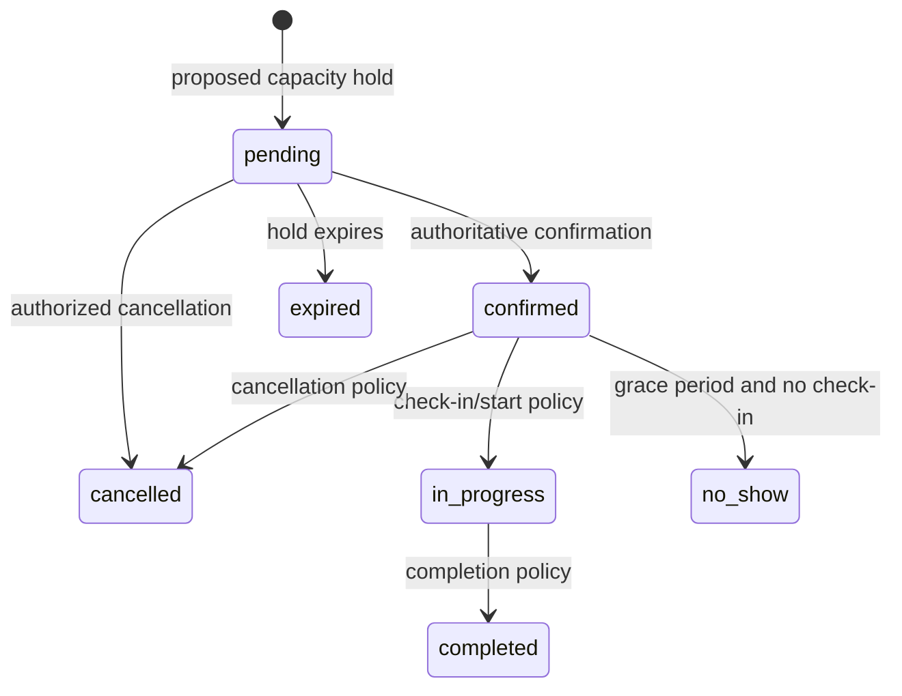
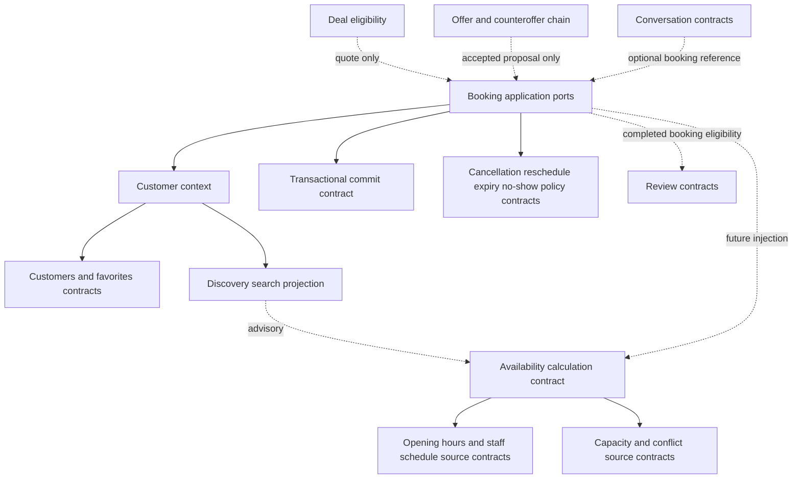

# Phase 6: proposed customer and booking architecture

All contracts are proposed. No endpoints, queries, booking algorithms, lifecycle
handlers, provider selection or real-time connections are implemented. Modules
follow domain/entities, application DTOs/ports/public types, server-only
infrastructure entries and structural presentation validation.

| Module       | Ownership                                                                            |
| ------------ | ------------------------------------------------------------------------------------ |
| customers    | Global user-linked customer profile; no global partner role                          |
| discovery    | Published business search projections and filters                                    |
| favorites    | Customer-owned store favorites with tenant/store references                          |
| availability | Advisory slots and source/calculation interfaces                                     |
| bookings     | Booking aggregate, item snapshots, staff assignments, lifecycle and policy contracts |
| deals        | Tenant-owned discount definitions and eligibility/redemption contracts               |
| negotiation  | Immutable offer/counteroffer chain and acceptance references                         |
| reviews      | Completed-own-booking review eligibility and moderated review records                |
| messaging    | Store/customer conversations, participants, messages and notification contracts      |

CustomerOperationContext requires a validated session and request-specific customer
authorization; never manufacture tenant membership for a customer. Organization
callers require current membership and organization-scoped authorization. Bind
customer identity from the session and derive organization from the verified
store/booking. Client IDs are selectors. Private collection access requires
self-bound query predicates; public search/availability requires approved active
listing projections. A customer_collection target is never an unrestricted tenant
scan. Staff/member roles receive no negotiation/messaging privileges by default.
Platform admins still have no implicit customer or tenant access.

## Search, favorites and profiles

Search contracts include text or coordinate/radius location, category IDs,
same-currency minimum/maximum price, service/time-window availability, sorting
(relevance, distance, price ascending/descending, rating, soonest), cursor and limit.
No spatial engine, category taxonomy, ranking or geocoder is selected. Future
validation must check price/time ordering, sort/filter compatibility, timezone,
canonical location and bounded query windows. Radius coordinates are not proof
of store location or user consent. Price conversions are not supported.

Favorites identify a particular store, not an ambiguous organization-wide business.
Only their customer may list/set them. Same customer/store uniqueness prevents
duplicates. Hidden/closed businesses must not leak private details through old
favorites. Customer profiles link one-to-one to global users; public display data
is distinct from authentication credentials. Locale/timezone semantics and profile
versus user display-name precedence remain proposed.

## Booking aggregate and lifecycle

Each booking has one tenant/store/customer, UTC half-open [start,end) range, revision,
idempotency key/fingerprint, payable money and policy snapshot. Service items
capture name, price, duration, per-line interval and optional staff assignment;
product items capture quantity and price without scheduling. Staff assignment
includes store and canonical membership, so multi-store staff are not accidentally
treated as independent people. Currency is inherited from the booking. New booking
DTOs deliberately omit customer/tenant, totals, status and duration snapshots.

These are specifications only. Rescheduling is a revisioned atomic change of
interval/items, not a terminal status. Terminal reopening and late-payment-after-
expiry behavior need explicit policies. Cancellation/rescheduling/expiration/
no-show assessment ports return decisions; no decision engine runs. Snapshot
cutoffs, fee currency, hold duration, grace interval and version on creation.
Refund issuance is separate from cancellation. Expiration/no-show worker authority
and check-in evidence are still deferred; plain timestamp input is not authority.
Retail-only orders, guest/group bookings, multiple assigned staff per item and
cross-organization staff conflict scope remain open.

## Availability interfaces

OpeningHoursSourcePort, StaffScheduleSourcePort, ServiceDurationSourcePort,
CapacitySourcePort and BookingConflictSourcePort feed AvailabilityCalculationPort.
Inputs include scoped opening hours, staff schedules/assignments, service duration,
capacity/resource revisions and blocking bookings with hold expiries. A branded
AvailabilityScope must be resolved server-side after listing/tenant authorization;
no resolver implementation or unsafe constructor exists.

Slots include observation time and snapshot version: they are advisory, never a
reservation, price guarantee or permission. Future calculation must handle store
and staff hours, archived/inactive resources, buffer times, canonical membership
across stores, capacity units, pending holds, DST ambiguity, date exceptions and
line ordering. Missing capacity/schedule/public-bookability policy fails closed.
No capacity table or availability algorithm is installed.

## Concurrency-safe future booking strategy

The correctness-first proposal serializes scheduling mutations per organization
using a stable organization row lock. This is intentionally coarse. Locking only
currently conflicting bookings cannot protect an empty interval from concurrent
inserts. PostgreSQL row locks coordinate access to the locked row; see the
[official locking documentation](https://www.postgresql.org/docs/17/explicit-locking.html).

1. Authenticate/authorize the exact customer/tenant operation; resolve store and
   all service/product/staff references. Treat any prior availability result as stale.
2. Begin a future READ COMMITTED database transaction and lock the organization
   row before reading mutable scheduling facts. Every scheduling, hold expiry,
   capacity, hours and staff-assignment writer must obey this same lock discipline.
   Reads after acquiring the lock use fresh snapshots. No in-memory mutex suffices
   across app processes. Later resource-level locking needs a separate reviewed design.
3. Recheck active tenant/store, membership where applicable, public-bookability,
   schedules, current prices/policies, capacity and overlapping half-open ranges.
   Canonical membership identifies staff across stores within this tenant. Read
   blocking holds/confirmed/in-progress bookings under that lock; cleanly expire
   old holds before deciding capacity. Do not rely on a dynamic now() index predicate.
4. Enforce a unique (customer_user_id,idempotency_key), compare a server-generated
   normalized fingerprint, and return the existing result only for the same request.
   A reused key with different store/items/time is a conflict. Insert booking,
   immutable line/policy snapshots and durable outbox events in that transaction.
5. Commit before payment/provider/event/network calls. Payment success does not
   recreate an expired slot: late success needs reconciliation/refund policy.
   Rollbacks must publish no committed event.
6. Rescheduling locks the same scope and verifies expected revision; retain old
   capacity until new capacity is validated and switched atomically. Cancellation,
   expiration and no-show transitions also use revision/state predicates. Retry
   deadlocks or serialization failures only with bounded whole-transaction retry
   and the same idempotency key, never a partially replayed workflow.

Current CHECK/FK/unique constraints enforce shape, tenant consistency and key
uniqueness, not capacity or overlap. A future single-capacity staff reservation
table could add a GiST exclusion on tenant + canonical membership + overlapping
tstzrange for held/confirmed allocations, requiring btree_gist. Multi-unit pooled
capacity needs its own transactional reservation model; a simple exclusion cannot
enforce capacity N. Neither exclusion DDL, extensions, reservation storage nor
transactions have been executed/implemented. Availability queries are not proof
of concurrency safety. All writers must follow the protocol before enabling booking.

## Deals, negotiation, reviews and messaging

Deals propose percentage/fixed discounts, windows and archive state. Eligibility,
currency matching, usage limits and redemption snapshots require future atomic
booking validation. Deal revision/redemption storage and stacking rules remain open.

Negotiation offers are immutable, reference their predecessor, and propose amount,
currency, time range and expiry. Acceptance requires the current offer/revision,
counterparty authority and atomic single acceptance. It is not a booking/payment:
revalidate availability, price, expiry and tenant ownership in a future booking
commit. Do not let a party accept its own offer. Offer limits, accepted-offer
reservation semantics and storage remain undecided.

Reviews propose one per completed booking; the composite FK enforces the same
customer/store/organization as the booking, while future eligibility checks must
still require completion and author ownership. Moderation status is server-owned;
only published reviews enter search projections. No moderation provider exists.

Conversations are store/customer-scoped with optional booking context. Every send
and read checks active authorized participation; organization recipients require
current membership, not a client participant list. Messages propose ordered
sequence and sender idempotency, bounded plain text and after-commit notification.
No WebSocket, provider, unread algorithm, attachments, retention or message tables
exist. Domain events/notifications connect later through injected contracts.

## Persistence and dependency diagrams

Proposed customer_profiles, favorites and reviews tables are added. Booking status,
holds, idempotency/fingerprint, revision/policy snapshot and per-item windows are
declared. The physical [ERD](../database/erd.md) and [dictionary](../database/data-dictionary.md)
reflect these definitions. No migration, connection or data write ran. Negotiation,
messages, capacity reservations and deal-redemption storage remain explicit gaps.

Dotted edges express future runtime collaboration, not domain imports. Domains
depend only on core. Availability application imports public schedule/service/staff
types; dependencies never reverse. All modules expose type-only public contracts.
