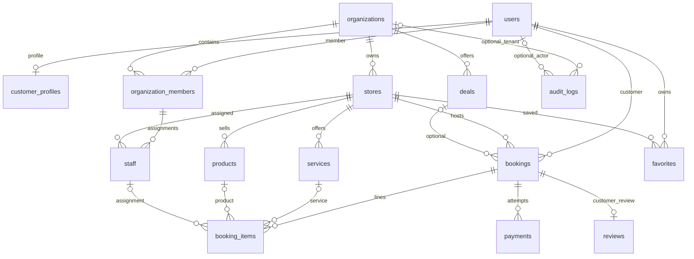

# Database architecture and ERD

There are 15 proposed tables, all in PostgreSQL public schema. Source domain
directories are logical ownership groups, not separate database schemas. No SQL,
migration, seed, connection, pool or RLS policy has been executed or installed.

The complete physical-column diagram is maintained in
[docs/database/erd.md](../database/erd.md); the complete column/constraint dictionary
is [docs/database/data-dictionary.md](../database/data-dictionary.md). The editable
diagram below is a relationship view of those same declared foreign keys. It does
not add proposed contracts as if they were physical tables.

Relationships are proposed. FKs carry organization_id and store_id where shared
by the related entities; reviews also bind the booking customer, and payments
bind booking currency. A nullable member of an optional composite FK uses MATCH
SIMPLE. Booking items enforce service/product exclusivity, not total consistency.
Every declared FK has a supporting leading-column index or unique key.

| Storage owner | Tables                                             |
| ------------- | -------------------------------------------------- |
| identity      | users, customer_profiles                           |
| organizations | organizations, organization_members, stores, staff |
| catalog       | services, products                                 |
| bookings      | bookings, booking_items                            |
| commerce      | deals, payments                                    |
| customers     | favorites, reviews                                 |
| audit         | audit_logs                                         |

All IDs are UUID primary keys; creation timestamps are time-zone-aware. Mutable
tables have explicit updated_at fields with now() defaults, not automatic update
triggers. Money is numeric(14,2) and string-valued in Drizzle; percentages are
numeric(5,2). Currency checks enforce uppercase three-letter shape only. Uniqueness
includes case-insensitive user email, organization slug, tenant membership,
store-local SKU, customer booking request key, tenant payment key and provider +
account + payment reference. RESTRICT deletes preserve references.

Only services/products use deleted_at. Stores/staff/deals archive, users disable,
and bookings/payments use explicit states. None of these fields automatically
filters reads or retires descendants. Audit append-only and JSON metadata
allowlisting are not enforced by the database.

Offline tests inspect Drizzle metadata and snapshot serialization, FK type/unique
targets, tenant/store tuples, supporting indexes, name limits, precision and
critical checks. They do not prove PostgreSQL accepts the DDL or that plans are
efficient. The dictionary now includes all physical table/column names, checked
by the final audit suite; semantic constraints still require human review.

Important gaps: most partner entities declare revision fields without matching
table columns; onboarding, photos, hours, visibility, negotiation, messaging,
capacity reservations, refund ledger, inbox/outbox, admin controls and settings
lack storage. The audit event contract is richer than audit_logs. Booking overlap,
cross-row totals, payment sums, lifecycle transitions and account-to-tenant
mapping need explicit future constraints and behavior. Review
[open questions](open-questions.md) before generating migrations.
