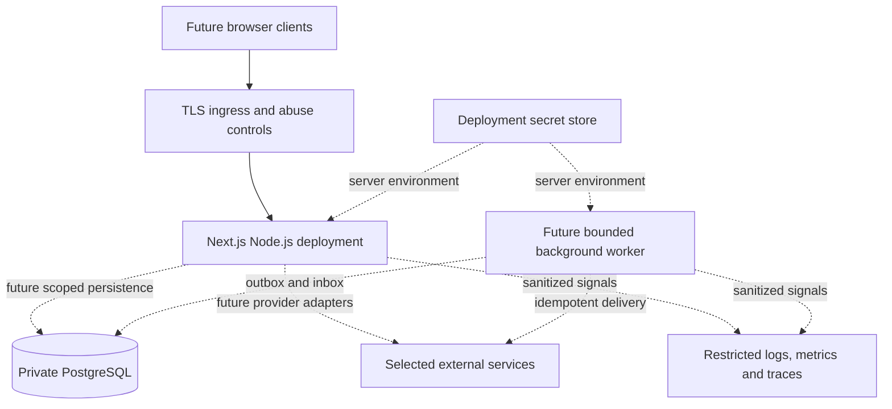

# Deployment proposal

This is an unimplemented vendor-neutral proposal, not a deployment guide for a
working booking service. No hosting provider, database instance, secrets store,
queue, email gateway, maps provider or payment processor has been selected.

Preserve App Router, strict TypeScript and the existing Cache Components/Turbopack
configuration. Use a maintained Node.js release compatible with package engines
(currently declared >=20.9.0; this audit runs on the locally installed version).
PostgreSQL 15+ is the repository's proposed baseline, subject to validation when
actual DDL is reviewed. Do not introduce edge-runtime database/provider adapters.

Build reproducibly with the lockfile, lint, typecheck, tests and next build.
Existing Google font compilation requires build-time network access or cached
assets; choosing self-hosted fonts later is a separate product/build decision.
No database credentials are required for the current architecture-only build.
Future bootstrap must call validateEnvironment explicitly before constructing
adapters; capability flags currently validate config only and activate nothing.

Use separate environments and credentials; keep PostgreSQL on restricted network
paths with TLS, least-privilege application grants and bounded pooling. A distinct
reviewed migration identity/job should apply migrations after backup/restore and
rollback/forward-fix planning. Never run migrations automatically from requests
or build workers. RLS remains an optional defense to decide and test, not a
claimed protection. Do not expose connection strings in client bundles.

Run durable outbox/reconciliation/expiry workers outside request lifetimes with
explicit service-actor authority, bounded concurrency/retries/deadlines and safe
shutdown. Share transaction/idempotency discipline across replicas. Define backup
restores, availability targets, recovery times, retention, rate limits, secret
rotation and incident access before production. Health contracts exist but there
are no health routes or checks; design private readiness probes and minimized
public liveness separately. Deploying this repository today deploys a starter UI.
