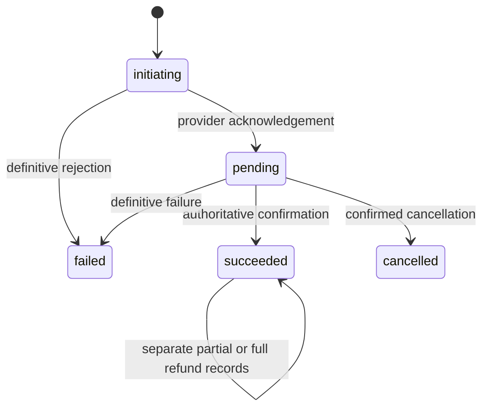
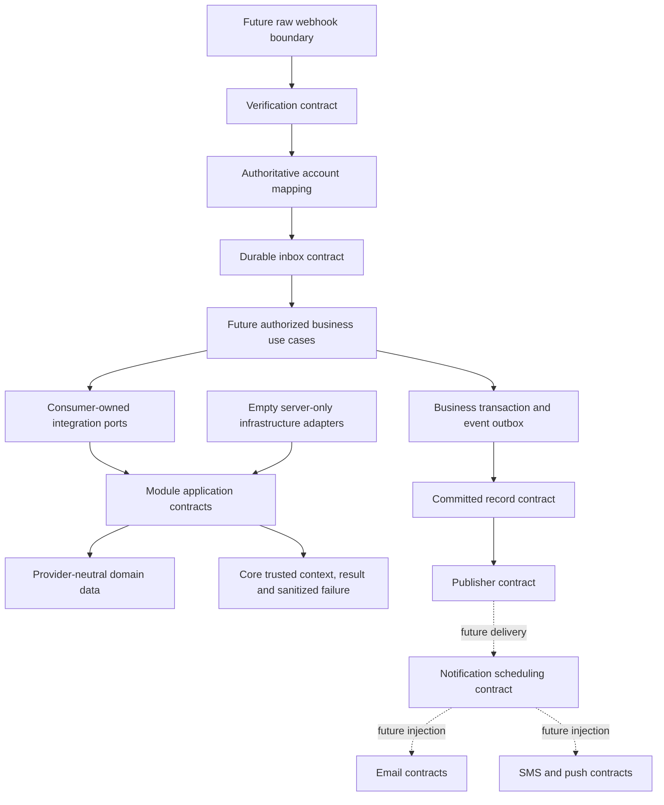

# Phase 7: external integration architecture

This phase provides provider-neutral data and interfaces only. No gateways,
SDKs, API requests, secret readers, live integrations, payment algorithms, webhook
routes, event brokers, uploads, retry loops or workers are implemented.

## Modules and boundaries

| Module        | Responsibility                                                                |
| ------------- | ----------------------------------------------------------------------------- |
| payments      | Attempts, initiation, cancellation and authoritative status lookup            |
| refunds       | Separate refund state, reservation and reconciliation contracts               |
| notifications | Intent, email/SMS/push channel routing and recipient preferences              |
| file-storage  | Owned assets, constrained transfer intents, reads, scanning and deletion      |
| maps          | Provider-neutral geocoding, reverse geocoding and distance results            |
| email         | Trusted template rendering and email delivery contracts                       |
| webhooks      | Raw-byte verification, account mapping, durable inbox and processing          |
| domain-events | Versioned event envelopes, transactional outbox, publisher and consumer inbox |

Each module uses domain/entities/model.ts, application/ports/contracts.server.ts,
application/public.ts (types only), an empty server-only infrastructure entry, and
deferred presentation contracts. Domain depends only on core; cross-module
integration uses consumer-owned ports and future server composition. Provider
secrets, SDK types and raw SDK errors must never enter domain/public DTO contracts.

IntegrationCallContext is an opaque server-derived context carrying authorized
operation/correlation IDs, tenant, actor, idempotency key/fingerprint, deadline and
attempt. It is not a client DTO or a new authentication mechanism. Future factories
must verify the originating operation/account or explicitly authorized worker;
none exists. A system-name string, branded cast or provider response confers no
permission. Financial operations must match tenant, booking/payment ownership,
amount, currency, provider account and intended action. Current payment/refund
authorization grants are not expanded: initiation/refund execution remains denied
until dedicated permissions, step-up and privilege policies are approved.

All executable ports/adapter entries import server-only. Pure types contain no
secret values; visibility of a type never authorizes serializing credentials,
raw webhook bytes, contact details, payment instruments or signed URLs to clients.

## Payments and refunds

Payment states: initiating, pending, succeeded, failed, cancelled. Refund summary
is a separate axis: none, pending, partially_refunded, refunded, failed. Refund
requests have requested, pending, succeeded, failed, cancelled states. A failed
refund does not turn a successful charge into a failed charge. Provider acceptance
or a redirect is not proof of settlement. No transition or amount calculation is
implemented; authorization/capture/settlement distinctions remain open decisions.

This diagram is proposed policy, not an implemented state machine. An initiation
timeout has unknown outcome; preserve the attempt and reconcile by original key
or provider ID. Never label it failed and create a fresh charge blindly. A cancel
timeout also needs reconciliation; late success must not be overwritten by stale
cancellation callbacks. Require amount/currency/account/object matches and apply
updates with local revision checks. Browser redirects do not confirm payment.

Refunds need a future durable reservation ledger, positive amounts in the original
currency, atomic remaining-refundable checks, same-account references, and unique
request keys. Pending refund reservations count against the balance; release only
on definitive failure/cancellation. Provider HTTP work stays outside DB locks.
Refund approval, partial capture, disputes, chargebacks, settlement and ledger
accounting remain open. No sensitive card details are modeled; instrument refs
are ephemeral secrets at the server boundary, not event payloads.

## Idempotency and ambiguous outcomes

For each logical mutation, store a normalized request fingerprint and stable key
before external work. Scope uniqueness by tenant + operation kind + key, and
provider namespace + account + provider request key. Same key/same fingerprint
returns the existing outcome; same key/different fingerprint is a conflict.
Keys cannot be reused for changed refund amounts or a different booking.

Persist initiating/pending state first, then call the provider with the same
idempotency key on every safe retry. After a timeout, the external side effect may
already exist. Use lookup/reconciliation; cancellation of a local request does
not prove cancellation at the provider. If a chosen provider cannot guarantee
safe idempotency or lookup, disable automatic retries for uncertain mutations
and require controlled reconciliation. Contracts do not guarantee exactly-once
external effects. Idempotency retention must outlive provider retry/replay windows;
duration and durable schema are still undecided.

## Webhook trust and processing sequence

1. Enforce future raw-body byte/header size bounds and preserve the exact received
   bytes. Verify signature and timestamp before JSON normalization or side effects.
   Use the configured endpoint's active/rotating signing keys, provider canonical
   rules, constant-time comparison and an explicit replay window/clock policy.
2. Produce opaque VerifiedWebhook only after cryptographic verification. This
   proves the source, not local tenant ownership or correctness of claimed state.
   Resolve provider/account/endpoint to an authoritative local organization;
   reject payload-supplied tenant IDs and unknown or mismatched accounts.
3. Durably record inbox uniqueness on provider namespace + account + event ID,
   with a signed-body hash. Same ID/different hash is an integrity conflict, not
   a harmless duplicate. Acknowledge only after durable acceptance; provider-specific
   response semantics remain deferred. Invalid requests never reach a handler.
4. Process under local transaction/revision checks. Duplicate delivery is expected;
   stale/out-of-order events cannot regress terminal state. Reconcile against
   authoritative provider state when ordering or effect is ambiguous. Signature
   success does not replace amount/currency/object matching.
5. Commit state and resulting outbox events together. Retry recoverable processing
   failures within a bounded policy; dead-letter exhausted/poison events. Audit
   manual replay and preserve the original deduplication key.

No inbox table, verifier, acknowledgment endpoint, crypto implementation or
processing handler exists. Raw payload retention, encryption, redaction and
retention windows must be decided before storing provider content.

## Storage, maps and communication

Storage policies distinguish business photos from private documents. Only approved
photo derivatives may be public. Every read/write/delete requires tenant/asset
ownership, purpose and retention checks. Future upload intents restrict object
key, method, content types, maximum bytes, checksum and short expiry; keys are
server-generated, not arbitrary client paths. Quarantine before scanning MIME,
size, checksum and content; only verified clean assets may become ready. Signed
URLs are short-lived capabilities, never credentials for buckets or provider APIs.
No URL signer, scanner, upload, lifecycle job or deletion handler is implemented.

Maps/geocoding returns coordinates, normalized address and accuracy. Results may
be approximate and cannot verify ownership or become an authoritative business
location automatically. Provider place refs remain opaque. Validate coordinate,
country/locale and payload bounds; geolocation consent, caching/license terms and
precision retention are undecided. No geocoder, routing or ranking algorithm runs.

Notifications use email, SMS and push, with queued/sending/accepted/delivered/
failed/suppressed/unknown-outcome states. Check recipient ownership, verified
destination, consent/preferences and suppression lists at dispatch. Provider
accepted is not recipient delivered. Coalesce/deduplicate using source-event,
recipient, channel and template/version, not raw email/phone as a metric key.
Email rendering uses registered templates and escaping, with header-injection
protection and server-controlled sender profiles. Do not send raw customer HTML,
session/reset tokens in logs, or arbitrary event variables without allowlists.
SMS length, push-token rotation, bounce/complaint processing and legal opt-outs
remain provider-independent future requirements.

## Domain events and delivery guarantees

DomainEvent is a type/payload-correlated versioned envelope with event ID, tenant,
aggregate/version, timestamp, correlation and causation. Payloads carry identifiers,
not credentials or message bodies. Modules emit through application ports; domains
do not import another module's event classes or SDKs. Tenant events are modeled;
platform/global events require a separate future schema and authorization policy.

Append events to an outbox in the same database transaction as business state.
EventTransactionContext is an opaque transaction handle; future adapters must bind
all event tenants to it. Only committed outbox records reach EventPublisherPort.
Use at-least-once publishing, stable event IDs and bounded retry, not exactly-once
claims. Broker acceptance is not consumer completion. Handle partial acceptance
per event; unacknowledged/ambiguous events remain eligible for safe replay.

ConsumerInboxPort.claimOnce includes the local transaction: deduplication and
local side effects must commit atomically. A claim committed before its effect
can lose work after a crash. External effects cannot share that DB transaction;
dispatch via another outbox/idempotent provider operation. Specify ordering per
aggregate/version; no global ordering guarantee is proposed. Outbox/inbox tables,
leases, recovery, broker, consumers and dispatchers remain unimplemented.

## Retry, timeout, failure and observability policy

| Category                                 | Required future behavior                                                      |
| ---------------------------------------- | ----------------------------------------------------------------------------- |
| Read-only transient/network/5xx          | Bounded retries with exponential backoff and jitter, within overall deadline  |
| Rate limited                             | Respect validated Retry-After within configured cap/deadline; never busy-loop |
| Timeout/unknown mutation outcome         | Preserve pending/unknown state, reconcile original key; no blind new mutation |
| Permanent validation/auth/config failure | No automatic retry; alert/actionable sanitized error                          |
| Invalid provider response                | Fail closed, preserve evidence safely, reconcile before changing money state  |
| Retry budget/deadline exhausted          | Durable retry queue or dead-letter/manual reconciliation; no fake success     |

Use per-attempt connect/read/write timeouts plus a total operation deadline.
Attempt count, concurrency limits, circuit-breaker windows, retry budgets and
numeric timeout values must be configured per adapter and verified against its
documentation; no fabricated universal defaults are installed. Retries at multiple
layers must share one budget. Never hold booking/payment DB locks across external
calls, backoff, email sends or broker publication.

Propagate correlation/operation/event IDs. Record sanitized provider namespace,
operation, result category, attempt, duration, retry schedule and reconciliation
age. Metrics cover timeout/rate/error rates, latency, circuit state, inbox/outbox
lag, dead-letter depth and unknown financial outcomes. Avoid high-cardinality
tenant/user/event labels in metrics and any secret/contact/raw payload logging.
Audit financial changes, signature failures, ownership mismatches and manual
replays. No telemetry exporter or observability provider is selected.

## Configuration, schema and dependency diagram

.env.example contains empty server-only example names. Phase 9 adds an explicit-input
environment validator, without reading process.env or creating clients. No default
credentials, live endpoint or provider SDK dependency is added. Avoid
NEXT_PUBLIC_ credentials. A future secret manager and rotation policy are required;
examples do not imply every deployment needs every key or separate refund credentials.

The proposed payments schema now includes initiating, provider account namespace,
refund summary, request fingerprint and revision. It is not a refund ledger.
Refunds, transfer metadata, webhook inbox, event outbox, delivery attempts and
reconciliation storage remain open proposals. No migration was generated or run.

Future tests must cover key reuse/fingerprint conflicts, duplicate/reordered
webhooks, key rotation, replay windows, tenant/account spoofing, ambiguous timeouts,
concurrent refunds, outbox rollback/crash recovery, consumer atomicity, private
document leakage, suppression and redacted errors. Current checks validate types
and architectural boundaries only; no external behavior is tested or claimed.
