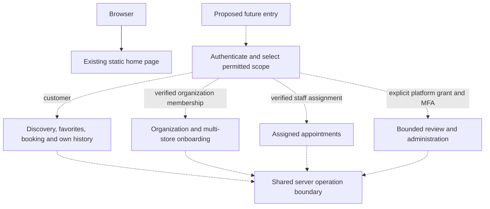

# Frontend flow

Current files: src/app/layout.tsx, page.tsx, globals.css and favicon.ico. The
layout sets VelvetBook metadata and Geist fonts; the page remains the Next.js
starter. There are no authored customer, partner, staff or admin screens, client
components, route groups, authentication redirects or protected layouts.

These future flows are navigation concepts, not route paths or a routing contract.
An individual may have both customer access and memberships in several tenants;
scope selection never merges privileges. Platform access must be provisioned
independently. Organization onboarding is Organization, Photos, Services, Products,
Staff, Visibility, Review; stores and hours feed those sections.

Future Server Components may obtain minimized authorized read DTOs through server
composition. Client Components receive serializable public data only, never
session/tenant proof objects, schemas, database handles or credentials. Every
mutation and subsequent read reauthenticates and reauthorizes on the server.
Hidden buttons, redirects and protected layouts are usability controls, not
authorization. Cache keys/invalidation must include the verified scope, and private
responses must never enter a shared public cache. Existing Cache Components
settings are preserved; no private caching policy has been implemented.
