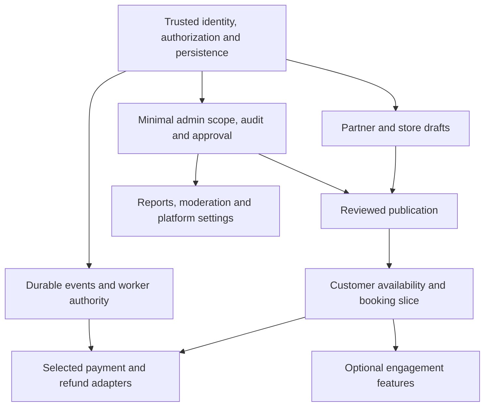

# Future API implementation roadmap

All 35 modules below have architecture contracts. No row represents a completed
API or use case. Operation names describe future capabilities, not selected URLs,
HTTP methods, transport versions or permission grants. Choose Route Handlers vs
Server Actions per use case after Q-19; do not bypass the same backend boundary.

Every slice requires strict input/output DTOs, server authentication, exact-action
authorization, tenant/customer ownership checks, scoped repositories, explicit
error mapping, audit needs and meaningful unit/security/integration tests. Writes
also require revision/idempotency/transaction rules as applicable. Future schema
migrations require separate review; this audit executes none.

## Stage A: trusted foundation

| Module        | Future operations                                              | Scope and prerequisites                                                                          |
| ------------- | -------------------------------------------------------------- | ------------------------------------------------------------------------------------------------ |
| identity      | Authenticate, validate/revoke sessions, recovery and MFA flows | Select provider, local account links, safe sessions and abuse controls; Q-01                     |
| authorization | Resolve tenant, ownership and exact operation decisions        | Internal server boundary; active grants/memberships, default deny, provisioning and TOCTOU tests |

Implement environment bootstrap, real clock/ID/logging adapters, transaction
adapter and explicit server composition as supporting infrastructure, not new
business APIs. First validate reviewed DDL in disposable PostgreSQL and prove
cross-tenant denials before building feature endpoints.

## Stage B: organization and partner capability

| Module          | Future operations                                       | Scope and prerequisites                                                                                 |
| --------------- | ------------------------------------------------------- | ------------------------------------------------------------------------------------------------------- |
| organizations   | Read/update organization draft and membership workflows | Owner/manager per matrix; first-owner bootstrap separate; persisted revisions                           |
| stores          | List/read/create/update store drafts                    | Verified organization and store parent; multiple stores, slug/timezone policy                           |
| staff           | Manage assignments and staff profiles                   | Owner/manager plus tenant/store checks; active membership, last-owner policy and cross-store scheduling |
| services        | Maintain service drafts, durations and prices           | Catalog permission, store scope, currency and eligibility policy                                        |
| products        | Maintain product drafts and prices                      | Catalog permission; decide inventory/variants and stable SKU policy                                     |
| business-photos | Register/reference authorized photo assets              | Tenant ownership, storage quarantine and scanning; no arbitrary URL/path trust                          |
| visibility      | Read/change proposed business visibility                | Explicit tenant authority plus approved/publication policy; missing storage                             |
| operating-hours | Manage store/staff schedules and exceptions             | Verified store/staff scope; persisted revisions and DST rules                                           |
| onboarding      | Save sections, inspect readiness and submit             | Tenant permission, immutable submission/evidence, all seven sections; no direct approval                |

## Stage C: minimal customer and booking slice

| Module       | Future operations                                                            | Scope and prerequisites                                                                                           |
| ------------ | ---------------------------------------------------------------------------- | ----------------------------------------------------------------------------------------------------------------- |
| customers    | Read/update customer profile                                                 | Session-derived self identity; no tenant-wide profile access                                                      |
| discovery    | Search/read eligible business projections                                    | Decide anonymous vs customer scope; bounded filters/cursors, publication and location storage                     |
| favorites    | List/add/remove saved stores                                                 | Customer ownership and verified eligible store; uniqueness handling                                               |
| availability | Request advisory slots                                                       | Verified publicly bookable target, schedules/durations/capacity/conflicts; no reservation promise                 |
| bookings     | Create hold, own/tenant/assigned reads, cancel/reschedule/lifecycle commands | Exact actor-specific action, full transaction lock discipline, policy snapshots, totals and state/revision checks |
| deals        | Read/manage eligible offers                                                  | Tenant management vs customer projection; currency, stacking/redemption and expiry                                |
| negotiation  | Offer/counter/accept/reject/expire                                           | Verified participants, bounded revisions/expiry; decide price binding and storage                                 |
| reviews      | Submit/read eligible review projections                                      | Booking/customer ownership and completion policy; moderation/publish states                                       |
| messaging    | Participant-scoped history/send contracts                                    | Resolve participants and retention/safety policy; choose durable storage before real-time transport               |

Start with the smallest reviewed booking subset. Defer negotiation/messaging and
optional deals until the base availability, tenant isolation and concurrent hold
tests pass. Staff uses the same booking module, filtered to active assignments.

## Stage D: durable effects and selected integrations

| Module        | Future operations                                                | Scope and prerequisites                                                                                        |
| ------------- | ---------------------------------------------------------------- | -------------------------------------------------------------------------------------------------------------- |
| domain-events | Append outbox, publish committed events and claim consumer inbox | Internal authorized workers, atomic state/events and deduplication storage; no general public event API        |
| webhooks      | Verify/accept/process provider events                            | Raw-byte signature, replay, account-to-tenant mapping and durable inbox; provider-specific ingress permission  |
| payments      | Initiate/read/cancel/reconcile attempts                          | Add reviewed command permissions and account ownership; current role matrix exposes reads, not charge mutation |
| refunds       | Reserve/initiate/read/reconcile refund outcomes                  | Explicit new policy/permissions, atomic remaining balance ledger and original account/currency                 |
| notifications | Schedule/channel delivery/preferences                            | Trusted event/actor, verified destinations, consent, deduplication and suppression                             |
| file-storage  | Constrained upload/read/delete and scan status                   | Asset purpose/tenant ownership, quarantine, private documents and retention; selected storage adapter          |
| maps          | Geocode/reverse-geocode/distance                                 | Bounded authorized use, privacy/license/caching and endpoint policy; no ownership inferred from coordinates    |
| email         | Registered template rendering and dispatch                       | Internal trusted intent only, escaping/header safety, sender registry and redaction                            |

Implement worker authority and durable delivery before invoking providers. Use
stable idempotency keys and reconcile ambiguous outcomes; never call providers
under booking locks. Integration helpers must not become unrestricted proxy APIs.

## Stage E: centralized administrative capability

| Module                 | Future operations                                                 | Scope and prerequisites                                                                                        |
| ---------------------- | ----------------------------------------------------------------- | -------------------------------------------------------------------------------------------------------------- |
| admin                  | Verify finite data scope and prepare sensitive action controls    | Separate platform grant, fresh MFA/reauthentication, independent approval and durable audit intent             |
| organization-approvals | Read cases and approve/reject onboarding                          | Exact sensitive platform review; consolidate legacy review ports, no self-review and evidence revision binding |
| user-management        | Minimized lookup, suspend/restore, revoke and controlled recovery | Exact bounded platform action, privileged/self/last-admin safeguards; provider recovery remains trusted        |
| moderation             | Review listings/reviews/reported content and decide               | Bounded target evidence, policy/version/reason, independent controls and source lifecycle port                 |
| reports                | Aggregate bookings/payments/business activity and export          | Explicit finite tenant set or platform area; aggregate projections and private expiring exports                |
| platform-settings      | Read registry, propose/approve/apply changes                      | Nonsecret allowlisted settings, separation of requester/approver, revision/fingerprint and rollback policy     |
| audit-logs             | Append trusted events, bounded read/export                        | Internal writer, tamper resistance/retention, separately authorized access and access auditing                 |

Administrative contracts are ready for implementation design, not safe to expose
as handlers today. Approval review may be needed before Stage C public booking;
build the minimal Stage E approval/audit slice with Stage B rather than waiting
for every optional integration. Module groups are dependency gates, not a fixed
product release schedule.

Release gates: authorization denial tests, disposable-database constraints and
rollback tests, competing booking transactions, webhook replay/idempotency,
sanitized errors/logs, sensitive audit atomicity and end-to-end user journeys.
No offline contract test replaces those future runtime checks.
