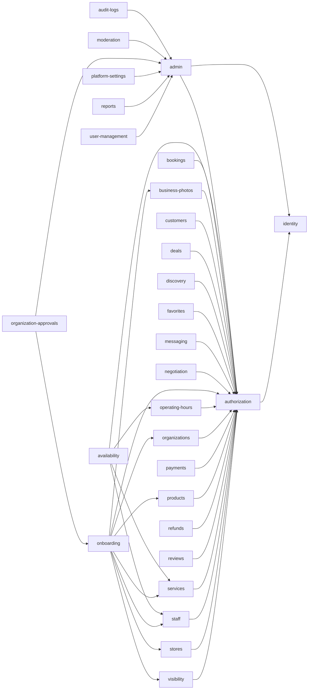

# Module dependencies

Generated from actual source imports by `node tooling/architecture/inventory.mjs --write`.
Arrows mean source depends on destination, including erased type imports.
No injected runtime dependency is implied. ESLint separately resolves local source
paths and checks cycles, re-exports and layer restrictions.

## Current cross-module graph

| Consumer               | Public type dependency | Import kind | Source files |
| ---------------------- | ---------------------- | ----------- | ------------ |
| admin                  | authorization          | type only   | 2            |
| admin                  | identity               | type only   | 1            |
| audit-logs             | admin                  | type only   | 1            |
| authorization          | identity               | type only   | 5            |
| availability           | authorization          | type only   | 1            |
| availability           | operating-hours        | type only   | 1            |
| availability           | services               | type only   | 1            |
| availability           | staff                  | type only   | 1            |
| bookings               | authorization          | type only   | 1            |
| business-photos        | authorization          | type only   | 3            |
| customers              | authorization          | type only   | 1            |
| deals                  | authorization          | type only   | 1            |
| discovery              | authorization          | type only   | 1            |
| favorites              | authorization          | type only   | 1            |
| messaging              | authorization          | type only   | 1            |
| moderation             | admin                  | type only   | 1            |
| negotiation            | authorization          | type only   | 1            |
| onboarding             | authorization          | type only   | 3            |
| onboarding             | business-photos        | type only   | 1            |
| onboarding             | organizations          | type only   | 1            |
| onboarding             | products               | type only   | 1            |
| onboarding             | services               | type only   | 1            |
| onboarding             | staff                  | type only   | 1            |
| onboarding             | stores                 | type only   | 1            |
| onboarding             | visibility             | type only   | 1            |
| operating-hours        | authorization          | type only   | 2            |
| organization-approvals | admin                  | type only   | 1            |
| organization-approvals | onboarding             | type only   | 1            |
| organizations          | authorization          | type only   | 2            |
| payments               | authorization          | type only   | 1            |
| platform-settings      | admin                  | type only   | 1            |
| products               | authorization          | type only   | 2            |
| refunds                | authorization          | type only   | 1            |
| reports                | admin                  | type only   | 1            |
| reviews                | authorization          | type only   | 1            |
| services               | authorization          | type only   | 2            |
| staff                  | authorization          | type only   | 2            |
| stores                 | authorization          | type only   | 2            |
| user-management        | admin                  | type only   | 1            |
| visibility             | authorization          | type only   | 2            |

Modules absent from this graph have no cross-module imports; they can still depend
on core. The reusable _template is not a business module. See the complete module
inventory in [the roadmap](future-api-roadmap.md).

## Allowed directions and ownership

Presentation imports its application; application imports its domain; infrastructure
implements its application ports. Domain imports only its own domain and core.
Other modules may import only types from application/public.ts; runtime coordination
uses consumer-owned ports injected by a future server composition root. No root
or dependency injection container exists today. Database FK dependencies are
separate from feature imports and use concrete schema files to avoid barrel cycles.

Core imports core only. Configuration imports core/configuration and Zod; shared
helpers import core/shared, with Zod limited to server validation files. Module
infrastructure may import shared infrastructure, db and config, plus external
packages. Module presentation cannot currently import shared response helpers; a
future transport/composition root can apply them outside the feature layer.

The import checker is a repository-specific guardrail, not a security sandbox.
New aliases, extension conventions, computed loads or indirect global access need
review. src/app, src/db and shared infrastructure do not have the same inward
module restrictions; cycle checks still apply to resolved local imports. Keep
future composition server-only and prohibit feature back-references there.
