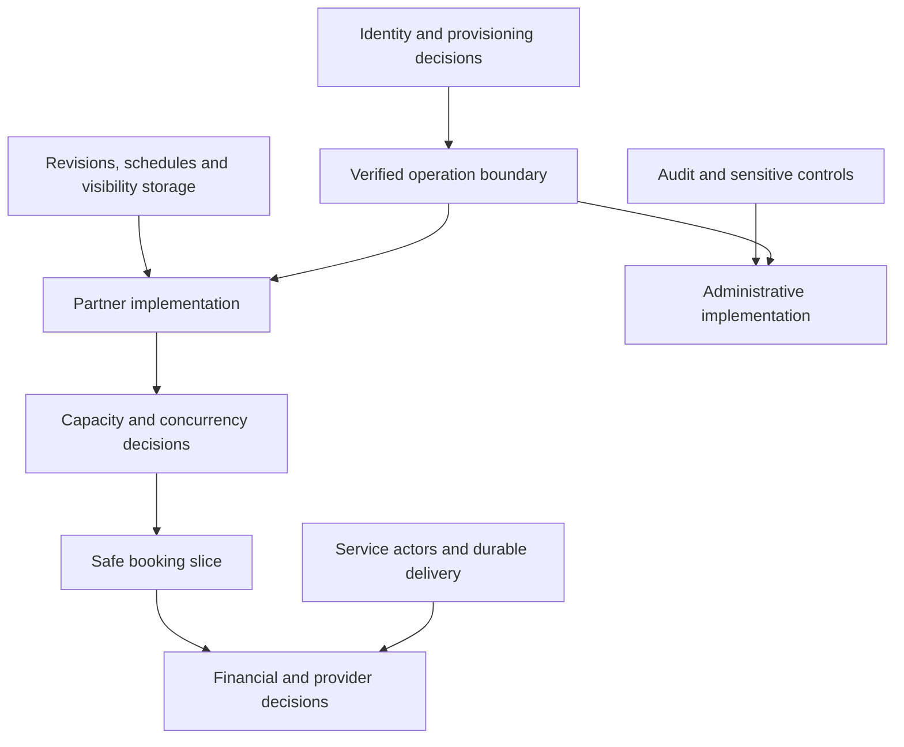

# Open questions and implementation gates

Nothing below is silently resolved by types or defaults. Owners are responsibility
categories to assign, not claims that a team/person has accepted ownership.

| ID   | Question or gap                                                                                                                         | Responsible review      | Gate                               |
| ---- | --------------------------------------------------------------------------------------------------------------------------------------- | ----------------------- | ---------------------------------- |
| Q-01 | Which identity provider, credential/account-link model, session/revocation store and MFA/recovery policy?                               | Security / identity     | Any authenticated operation        |
| Q-02 | How are the first organization/owner and platform grants provisioned, invited and recovered?                                            | Product / security      | Tenant onboarding and admin access |
| Q-03 | Last-owner/admin protections, multiple organization roles and contractor staff without accounts?                                        | Product / security      | Membership mutation                |
| Q-04 | Consolidate older OnboardingReviewContext ports with sensitive admin controls; prohibit lower-assurance direct review                   | Security / approvals    | Exposing any review operation      |
| Q-05 | Most partner domain entities carry revisions not persisted in existing tables; choose version/history storage                           | Persistence / partner   | Optimistic draft writes            |
| Q-06 | Organization vs store approval, immutable evidence, edit-after-submit, rejection/resubmission and publishability rules?                 | Product / partner       | Onboarding and discovery           |
| Q-07 | Anonymous discovery allowed, or authenticated customers only? Current candidate search capability is customer-scoped                    | Product / security      | Public search                      |
| Q-08 | Visibility, photos, private documents, schedules, timezone/DST exceptions and staff-service eligibility storage?                        | Partner / persistence   | Bookability and uploads            |
| Q-09 | Shared catalogs, product variants/inventory, guests/groups, product-only bookings, minimum lines and multi-staff services?              | Product / booking       | Booking schema approval            |
| Q-10 | Same staff across organizations, pooled capacity/resources and reservation/exclusion design?                                            | Booking / persistence   | Concurrency-safe booking           |
| Q-11 | Cancellation/reschedule/no-show fees, holds, late payments, currencies/tax/rounding and total reconciliation?                           | Product / finance       | Booking/payment effects            |
| Q-12 | Payment provider/account ownership, capture/settlement, refund reservation ledger and overpayment prevention?                           | Finance / security      | Payment integration                |
| Q-13 | Worker/service-actor grants, inbox/outbox schema, deduplication retention, leases and recovery?                                         | Security / operations   | Background effects/webhooks        |
| Q-14 | Deal redemption limits/stacking, negotiation acceptance/expiry and messaging/review eligibility/privacy?                                | Product / customer      | Engagement features                |
| Q-15 | Admin change requests, independent approvals, scope evidence, report snapshots and platform settings persistence?                       | Security / admin        | Administrative operations          |
| Q-16 | Audit contract-to-table mapping: correlation, operation, actor kind, outcome, timestamp and redacted metadata; append-only enforcement? | Security / persistence  | Sensitive writes and audit reads   |
| Q-17 | Tenant query predicates alone or additional RLS, and how to verify background/platform scopes?                                          | Security / persistence  | Live persistence                   |
| Q-18 | Deployment region, hosting, pooling, backup/restore, SLOs/RPO/RTO, incident access and secret rotation?                                 | Operations              | Production release                 |
| Q-19 | Transport choice/path/versioning, CSRF/origin policy, abuse limits, cursor signing and private cache behavior?                          | Platform / security     | First API or Server Action         |
| Q-20 | Provider-neutral config groups/defaults need provider-specific completeness, endpoint allowlists and timeout/replay review              | Integrations / security | Enabling capabilities              |

Remaining evidence gaps: no PostgreSQL DDL execution/query-plan tests, runtime
authorization tests, browser flows, provider contract tests, load tests, restore
drills or deployed observability. Passing offline checks does not close those
gaps. See the [roadmap](future-api-roadmap.md) for implementation order.
