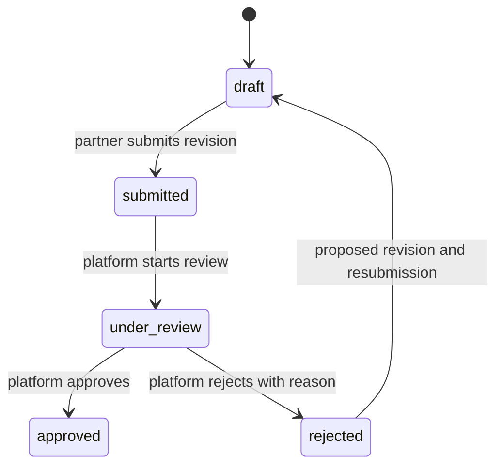
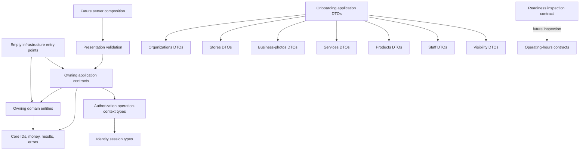

# Phase 5: proposed partner architecture

Nine modules extend the modular monolith. These are proposed data shapes and
contracts, not running workflows. No endpoints, queries, uploads, transition
handlers, publication logic or repository implementations exist.

## Structure and ownership

Each module contains domain/entities/model.ts, application/dtos/contracts.ts,
application/ports/repository.server.ts, application/use-cases/manage.server.ts,
application/public.ts, infrastructure/index.ts and presentation/validation.server.ts.
Domain entities contain readonly data; repositories and use cases are interfaces.
Public files export only types. Individual ownership is pending assignment to
partner-domain maintainers, as recorded in each module README.

| Module          | Owns                                                                | Proposed scope                            |
| --------------- | ------------------------------------------------------------------- | ----------------------------------------- |
| organizations   | Profile and lifecycle                                               | Tenant root                               |
| stores          | Profile, timezone, archival                                         | Many stores per organization              |
| staff           | Member-to-store assignments                                         | Member can work at several stores         |
| services        | Names, duration, price, retirement                                  | Store-local services                      |
| products        | SKU, descriptions, price, retirement                                | Store-local products; no inventory        |
| business-photos | Placement, asset reference, alt text, ordering, moderation metadata | Organization or store; no binary handling |
| visibility      | Requested listing mode and booking preference                       | Proposed settings per store               |
| operating-hours | Opening/working hours and dated exceptions                          | Store or staff assignment within store    |
| onboarding      | Selected stores, progress, submission, review references            | Proposed organization-wide application    |

Authorization remains owner of role/membership access facts; identity owns users.
Staff owns assignments, not another identity or role source. Authorization's
StaffAssignment remains a minimal access projection rather than the staff entity.

## Tenant isolation and permission mapping

All repository reads/lists/writes and partner use cases require
OrganizationOperationContext: validated session, verified tenant, and an
organization-scoped AuthorizedOperation. Future implementations must compare
subjects, tenant, action and target, recheck mutable state, and bind every query
to the same tenant/store. A context shape or type cast cannot establish trust.

Draft bodies omit organization ID, approval state, revision and authorization.
Target/store/member/asset IDs, selectedStoreIds and cursors are still untrusted
selectors, even when UUID parsing succeeds. Verify all nested references server-side.
Lists have explicit limit and cursor inputs; future adapters must enforce bounds
and tenant/store-bound cursors. No unscoped repository methods are supplied.

| Operation family            | Proposed permission and additional checks                            |
| --------------------------- | -------------------------------------------------------------------- |
| Organization edit           | organization.update; ID equals context tenant                        |
| Store create/edit           | store.create/store.update; create under verified organization parent |
| Staff assignment            | staff.manage; same-tenant member/store, no implicit role grant       |
| Services/products           | catalog.manage; verified target store                                |
| Organization/store photos   | organization.update/store.update; owned clean asset                  |
| Visibility                  | store.update; does not grant publication approval                    |
| Store/staff hours           | store.update/staff.manage; verify store and assignment               |
| Onboarding read/edit/submit | onboarding.read/update/submit                                        |
| Platform review             | platform onboarding.review; fresh MFA and onboarding ownership       |

Owner/manager receive proposed store-create and onboarding capabilities. Updating
an onboarding section never grants downstream organization.update, catalog.manage
or staff.manage: each delegated operation needs its own matching authorization.
Review uses platform authority without inventing a tenant membership. Platform
admins still have no general access to partner operations.

Organization bootstrap/first-owner establishment needs a separate future workflow.
Current organization edits require an existing active tenant membership. No
anonymous creation path or grant provisioning is introduced.

## Onboarding alignment

Canonical order: **Organization, Photos, Services, Products, Staff, Visibility,
Review**. Stores live within Organization; hours remain separate supporting
contracts. No extra Stores or Operating Hours onboarding step is introduced.

Organization includes profile and selected store details. Services, products and
staff carry store-scoped draft references. Photos carry owned asset references,
never files, arbitrary URLs or upload credentials. Visibility carries preferences,
not publication decisions. Review is partner confirmation of the current revision,
distinct from the platform review decision.

OnboardingSectionSubmissionDto references the other modules' public DTOs through
type-only imports. The section envelope schema validates a label and leaves payload
unknown. OnboardingSectionValidationPort must later delegate to each module's
validator and verify tenant references; a valid envelope is not a valid submission.
OnboardingReadinessPort is a consumer-owned inspection contract, with no computed
readiness implementation. Optional sections and not-applicable rules remain open.

These arrows are specifications only. Domain unions distinguish draft without
submission/review, submitted/under_review with submission time, and decisions
with reviewer/time and required rejection reason. Future logic must enforce
transitions, immutable submitted snapshots, conflict checks, readiness and no
self-review. Approval does not automatically publish or enable bookings.
Withdrawal, re-approval after edits and reviewer assignment are unresolved.

## Model semantics and validation limits

Money is a string amount plus currency; structural schemas accept nonnegative
fixed two-decimal amounts within numeric(14,2) and uppercase three-letter codes.
No calculations, currency registry validation, taxes or shared catalogs exist.
Service duration is positive integer minutes. Inventory/variants remain open.

Staff assignment requires a real same-tenant member and store. Role, membership
status and archival must be checked independently: assignment never promotes a
user to staff/manager/owner.

Hours use local minutes (start 0–1439, end 1–1440), seven weekday entries (Monday
is 0), empty intervals for closed days, and dated overrides. Interval ordering,
overlap, one entry per weekday, unique exception dates, IANA timezone validity,
overnight splitting, DST, and staff-hours containment require future domain
validation. Current schemas check primitive bounds/cardinality/date shape only;
there is no availability calculation.

Visibility proposes hidden, unlisted and listed modes with a bookingEnabled
preference. Actual exposure needs active tenant/store, approved onboarding,
moderation and future publication policy. A parsed draft is not public-bookability
authority. Photo ownership, content scanning and moderation need future adapters.

Zod is permitted only in server-only presentation/validation.server.ts through a
narrow lint exception. Domain/application remain free of packages. Schemas reject
unknown object fields and enforce bounded primitive shapes, not authorization,
uniqueness or cross-module invariants. Limits are proposed boundary limits.

## Persistence gaps and concurrency

The existing Drizzle schema is preserved. Revisions, onboarding snapshots, photos,
visibility and schedules have no storage yet. Staff membershipId maps conceptually
to organization_member_id; Money maps to price/currency. No mapping adapters or
migrations exist. expectedRevision null is create-only; a concrete revision needs
an atomic compare in future writes. IDs/revisions are created by trusted future
application code, not copied from clients.

## Dependency diagram

Cross-module arrows are type-only public application contracts. Onboarding depends
on feature DTOs; features never depend back on onboarding. Future runtime adapters
are injected through consumer-owned ports.

Run lint/typecheck, architecture tests and test:partner-contracts. Current tests
cover structural validation, tenant/state injection, money precision and review
input. Future behavior tests must cover cross-tenant/store/member/asset denial,
optimistic conflicts, lifecycle transitions, snapshot consistency, reviewer
authority, schedule invariants and publication gates before workflows are enabled.
