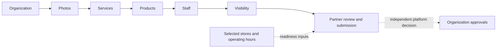
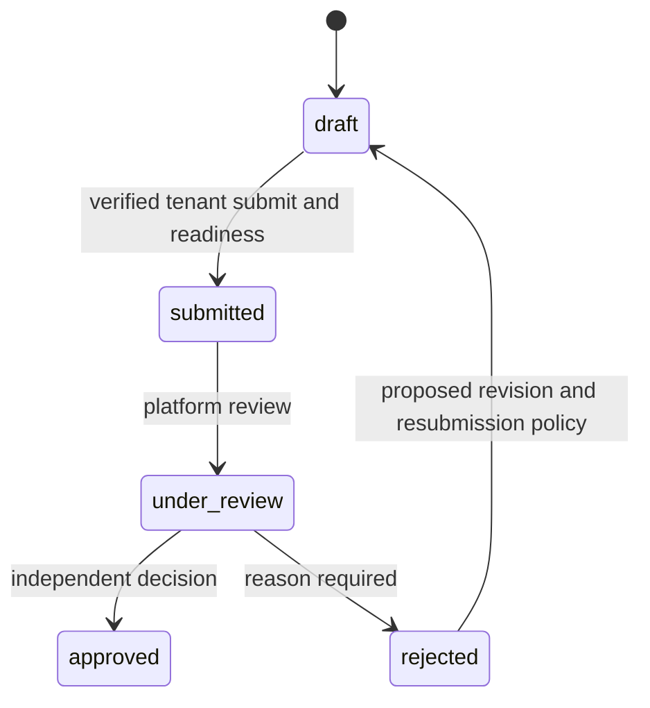

# Partner onboarding proposal

Partner means an organization member acting as owner or manager. Users have no
global partner role. One organization may have multiple stores; staff assignments,
services, products, hours and visibility require tenant/store verification.

The seven section identifiers are organization, photos, services, products, staff,
visibility and review. Section progress is not_started, in_progress, complete or
not_applicable. Saving a draft does not publish a listing, grant a role or approve
an organization. No onboarding data is stored yet.

States and arrows are proposed, not an implemented state machine. Review evidence
must bind organization, selected stores, submission revision and exact fingerprint.
An owner cannot review their own submission. Approval must use the centralized
admin sensitive-action controls, fresh MFA, independent approval and durable
audit intent before changing downstream visibility. Approval and publishability
are distinct; the existing organizations.status default active proves neither.

The older onboarding review ports accept OnboardingReviewContext, which is weaker
than the Phase 8 SensitiveAdminContext. The approvals bridge exists as a contract
but does not prevent direct future invocation of those older ports. Before
implementation, consolidate or make the older path internal and verify the
stronger context end-to-end. No second lower-assurance review entry point may be exposed.

Initial organization/first-owner provisioning is not covered by draft management
contracts, which already require an organization context. Decide invitations,
last-owner protection and bootstrap authorization before exposing create/join flows.
Onboarding, readiness/evidence history, photos, operating hours and visibility do
not have physical tables. Confirm revision storage, immutable submissions,
resubmission rules and whether approval is organization-wide or store-specific.
