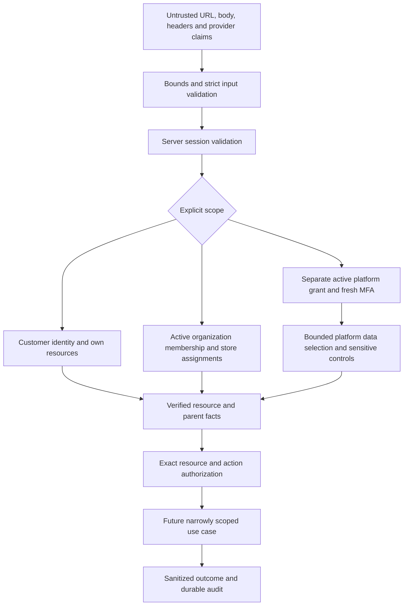

# Security and tenancy audit

Security architecture is shared across customer, partner, staff and admin. The
types and static permission matrix are present; authentication, authorization,
tenant resolution, ownership verifiers, MFA/session handling and audit writers
are not implemented. There is no claim of runtime tenant isolation.

| Scope                | Candidate access                                                                               | Required future restriction                                                            |
| -------------------- | ---------------------------------------------------------------------------------------------- | -------------------------------------------------------------------------------------- |
| Customer             | Own profile, favorites, negotiations/conversations, booking creation/history and payment reads | Derive user from session; verify each resource and publicly bookable target            |
| Organization owner   | Organization, membership and store/catalog/staff management                                    | Active matching membership; parent/store checks; last-owner policy                     |
| Organization manager | Operational management within tenant                                                           | No membership management, platform grant or payment mutation                           |
| Staff                | Store/catalog read, assigned booking read/update                                               | Active staff role AND matching store assignment AND assigned booking items             |
| Ordinary member      | Empty organization capability bundle                                                           | Deny organization operations by default                                                |
| Platform admin       | Explicit review, account, moderation, report, settings and audit capabilities                  | Separate grant; bounded verified selection; no implicit tenant role or wildcard bypass |

The exact candidate matrix is [here](../security/permission-matrix.md). It is not
an access-decision implementation. Organization IDs supplied by clients are only
selectors: resolve active server-side membership, match session subject and
verify all parent/tenant/store identities. Customer access does not require
membership and grants no tenant-wide reads. Provider role claims cannot create
local privileges. Unknown, missing, stale or unavailable verification denies.

Composite tenant/store FKs protect relationship consistency; they do not filter
queries. Every future list, nested lookup, aggregate and export needs explicit
scope predicates. RLS is not configured. Platform reports/audit exports require
verified finite tenant sets or a defined platform-only area, not all-tenant SQL.
Admin mutations require exact-action context, recent MFA/reauthentication,
independent approval bound to input, idempotency and durable audit. Recheck
mutable facts close to writes to avoid stale-context races.

Every db/infrastructure entry and *.server.ts file requires server-only; core and
domain stay framework-independent. Next.js enforces transitive client exclusion.
No authored client components currently consume backend code. Proof brands and
import rules prevent mistakes; casts, deserialized JSON or arbitrary callers do
not establish trusted runtime authority. Audit metadata is not yet constrained
in PostgreSQL, and append-only is convention until grants/storage are designed.

Open security gates: initial tenant/grant provisioning, last-owner/admin policies,
identity linking, session revocation, worker/service actor authority, public discovery
permission policy, cache segregation, rate/abuse limits, CSRF/origin controls for
future transports, webhook replay and durable inbox, secret rotation, privacy and
data retention. Consolidate the weaker onboarding review contract before exposure.
See [open questions](open-questions.md) and the [authorization test specifications](../security/authorization-test-specifications.md).
