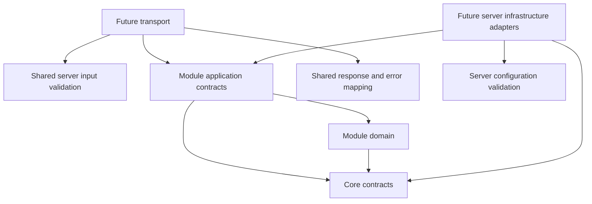

# Shared backend infrastructure

Phase 9 adds contracts and pure boundary helpers. No bootstrap, endpoint,
database connection, transaction runner, logger backend, health probe or provider
is implemented. Feature errors and existing ports remain compatible.

Core owns stable transport-neutral types: errors/results, request context, clocks,
identifier generation, pagination, transactions, logging, health and telemetry.
It imports only core. Configuration imports core, configuration, Zod and the
server marker. Shared helpers import core and shared; Zod is restricted to server
validation files. Feature imports, SDKs and database dependencies are forbidden in
these layers by ESLint. Module application ports continue to own feature-specific
behavior. Server composition will call shared helpers before invoking those ports;
application and domain code must not import presentation helpers.

## Error and response specification

Domain errors describe invariant failures with a domain discriminant and a
module-owned code union. Existing application errors retain code/message shape;
new boundary code uses ClassifiedApplicationError with an explicit category.
Each future use case must deliberately translate domain and repository failures
to a classified application error. Never infer authorization or HTTP status from
an arbitrary exception message, database exception or legacy string code.

Future JSON responses use ApiResponse<Data>: success contains ok:true, data and
meta; failure contains ok:false, error and meta. Metadata carries server-established
request and correlation IDs. Paginated data uses CursorPage<Item>. Dates in DTOs
must serialize to ISO 8601 UTC strings; money remains decimal strings. Empty 204
responses and streaming transports need separate transport contracts.

| Category        | Status | Public code       |
| --------------- | ------ | ----------------- |
| validation      | 400    | VALIDATION_FAILED |
| unauthenticated | 401    | UNAUTHENTICATED   |
| forbidden       | 403    | ACCESS_DENIED     |
| not_found       | 404    | NOT_FOUND         |
| conflict        | 409    | CONFLICT          |
| rate_limited    | 429    | RATE_LIMITED      |
| unavailable     | 503    | UNAVAILABLE       |
| internal        | 500    | INTERNAL_ERROR    |

The server-only pure mapper emits fixed messages and never copies internal error
codes, messages, exceptions or causes. Unexpected exceptions use the generic 500
mapper and separate sanitized logging. Only server-created validation issues may
be passed to it, with at most 50 issues. Validation uses schema-owned public field
labels; unknown/private paths become null. No input values, Zod messages, unknown
key names or provider payloads appear in public failures. Future adapters may
intentionally return not_found for inaccessible resources to limit enumeration;
this requires an explicit policy, never a skipped authorization check.

## Input and configuration boundaries

Accept unknown at the transport boundary, enforce content type/body-size/depth
limits, parse with a strict module schema and validate before use-case execution.
validateInput is synchronous; async refinements need a future explicit adapter.
Normalize query strings explicitly; pagination does not coerce strings to numbers.
Cursors must eventually be signed or validated server-side and bound to tenant,
subject, filters and stable ordering. A cursor never grants access. Maximum page
size is configured and capped at 1000; oversized cursors are rejected.

validateEnvironment accepts an explicit object and returns a Result. It never
reads process.env or runs at import time. A future server bootstrap must validate
once before constructing adapters, fail closed on invalid configuration, and
report only sanitized key/code pairs. Never serialize or log the successful
configuration object. Blank optional examples are treated as unset; flags accept
only true/false strings, and integers require canonical positive digits.
Known NEXT_PUBLIC_ credential aliases are rejected. This is a guardrail, not a
replacement for secret scanning and deployment configuration review.

Capability flags validate proposed credential groups only and create no clients.
All capabilities default disabled, including production architecture builds.
Provider-specific credential completeness, endpoint allowlists, SSRF controls,
secret rotation, replay limits and timeouts require review when providers are
selected. Current numeric defaults/bounds are proposed operational limits;
they are not universal provider policies. The existing integration policy remains
authoritative for retries, idempotency, webhook verification and outbox delivery.

## Cross-cutting implementation requirements

- Use injected Clock and IdentifierGenerator ports; no feature-owned clock or
  random-ID implementations. IDs are nominal types without unchecked constructors.
- TransactionManager is a future port. Its branded context proves participation,
  not authorization. Resolve membership/platform scope before opening a transaction.
  A Result failure or exception must roll back; retries must rerun the whole unit
  with bounded attempts, deadline and stable idempotency key. Define nested
  transaction behavior before implementing adapters. Callbacks contain database
  work only; no provider calls or irreversible side effects. Persist events in the
  same transaction through the existing domain-events outbox contracts.
- Reuse the existing EventPublisher and EventTransactionContext; the latter now
  extends the shared transaction proof and keeps tenant/outbox branding. Delivery
  remains at least once with consumer deduplication; no synchronous event bus exists.
- Establish and validate request/correlation IDs on the server. Bound length and
  accepted characters for any propagated header; replace invalid/untrusted IDs.
  IDs are diagnostic and never authority. Authentication, explicit authorization,
  verified tenant ownership and validated input remain mandatory for each operation.
- StructuredLogger accepts closed attributes and request context. Future sinks
  must use stable event names and redact at ingestion. Never log bodies, tokens,
  credentials, email addresses, payment details, stacks with secrets, or raw errors.
  Subject/tenant IDs need retention/access controls. Diagnostic logs do not replace
  durable audit events for sensitive actions.
- Metrics use fixed names and bounded labels: no user, tenant, request, URL or
  correlation IDs in metric labels. Traces/logs carry correlation under restricted
  access. Future adapters must enforce deadlines and emit sanitized outcome,
  duration, dependency failures and retry signals without installing an SDK here.
- HealthProbe and HealthReport define internal health data only. Liveness reports
  process health; readiness reflects configured critical dependencies. Disabled
  capabilities return not_configured and are noncritical. Probe implementations
  must honor deadlines and expose no hosts, credentials or provider exceptions.
  Public health transport, authentication and response minimization remain future work.

See [testing strategy](../testing-strategy.md) for verification boundaries.
