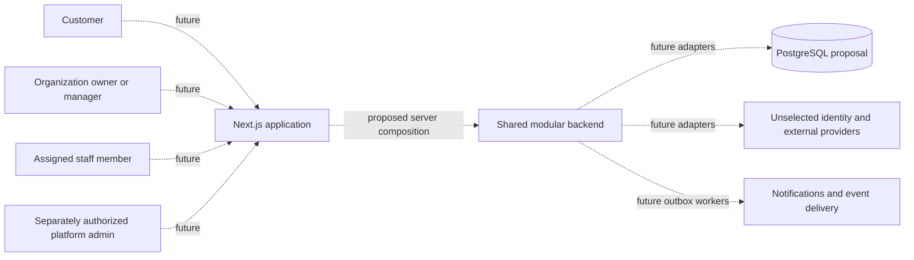

# VelvetBook system context

Final architecture-only audit, 2026-11-13. This repository contains one Next.js
App Router application, 35 contract modules and 15 proposed PostgreSQL tables.
The only authored page is the starter home page. Actors below are supported by
types and proposed permissions, not working experiences or authenticated flows.

All actor groups share identity, authorization, errors, validation, transaction,
logging and domain contracts. There are no separate partner/staff/admin backends,
role-specific database connections or duplicate booking implementations. Customer
ownership, organization membership/store assignment and explicit platform grants
are different access scopes over that shared architecture.

External providers, PostgreSQL, workers and a composition root are outside the
implemented runtime. Installed pg/Drizzle packages do not imply a connection.
The existing UI uses next/font/google at build time and external documentation
links; these are not business integrations. There is no production deployment
configuration, authenticated UI, API, session engine or adapter implementation.

Start with [audit results](audit-results.md), the [complete tree](project-tree.md),
[backend structure](backend-architecture.md), [actual dependencies](module-dependencies.md)
and the [future API roadmap](future-api-roadmap.md). All diagrams are editable
Mermaid source inside Markdown; future arrows are proposals.
