# Proposed PostgreSQL ERD

Every business relationship is proposed; review the [open questions](../../src/db/README.md)
before adopting it. The diagram shows declared FKs, not a complete business model.
See the [data dictionary](data-dictionary.md) for every column, default, check,
unique constraint, and index. All mutable tables also have `created_at` and
`updated_at`; audit rows have only `created_at`.

Composite FK tuples include `organization_id` and, when both sides are
store-scoped, `store_id`. Payment references additionally include `currency`.
Those tuples enforce a single tenant/store even though the diagram abbreviates
the parent identity to `id`. Optional service/product references are mutually
exclusive through a CHECK constraint. A booking can currently have zero items;
requiring at least one line needs future behavior or additional constraints.

```mermaid
erDiagram
    users ||--o| customer_profiles : "optional customer profile (proposed)"
    users ||--o{ favorites : "own favorites (proposed)"
    stores ||--o{ favorites : "favorite store (proposed)"
    bookings ||--o| reviews : "same customer composite FK (proposed)"
    users ||--o{ organization_members : "holds memberships (proposed)"
    organizations ||--o{ organization_members : "has members (proposed)"
    organizations ||--o{ stores : "owns stores (proposed)"
    organization_members ||--o{ staff : "store assignments (proposed)"
    stores ||--o{ staff : "assigns staff (proposed)"
    stores ||--o{ services : "offers services (proposed)"
    stores ||--o{ products : "offers products (proposed)"
    stores ||--o{ bookings : "hosts bookings (proposed)"
    users ||--o{ bookings : "registered customer (proposed)"
    organizations ||--o{ deals : "offers deals (proposed)"
    deals |o--o{ bookings : "optional discount (proposed)"
    bookings ||--o{ booking_items : "contains lines (proposed)"
    services |o--o{ booking_items : "optional service reference"
    products |o--o{ booking_items : "optional product reference"
    staff |o--o{ booking_items : "optional service staff (proposed)"
    bookings ||--o{ payments : "attempts in same currency (proposed)"
    organizations |o--o{ audit_logs : "tenant or platform event (proposed)"
    users |o--o{ audit_logs : "optional actor (proposed)"

    users {
        uuid id PK
        varchar email UK "case-insensitive expression index"
        text display_name
        timestamptz disabled_at "nullable"
    }
    customer_profiles {
        uuid id PK
        uuid user_id FK,UK
        text display_name
        text locale
        text timezone "nullable"
        integer revision
    }
    favorites {
        uuid id PK
        uuid customer_user_id FK
        uuid organization_id FK
        uuid store_id FK
    }
    reviews {
        uuid id PK
        uuid organization_id FK
        uuid store_id FK
        uuid booking_id FK
        uuid customer_user_id FK
        integer rating "1 through 5"
        text body
        text status
    }
    organizations {
        uuid id PK
        varchar slug UK
        text name
        text status
    }
    organization_members {
        uuid id PK
        uuid organization_id FK
        uuid user_id FK
        text role "organization scoped"
        text status
    }
    stores {
        uuid id PK
        uuid organization_id FK
        varchar slug "unique within organization"
        text name
        text timezone
        timestamptz archived_at "nullable"
    }
    staff {
        uuid id PK
        uuid organization_id FK
        uuid store_id FK
        uuid organization_member_id FK
        timestamptz archived_at "nullable"
    }
    services {
        uuid id PK
        uuid organization_id FK
        uuid store_id FK
        text name
        integer duration_minutes
        numeric price "14 digits, 2 decimals"
        char currency
        timestamptz deleted_at "nullable, catalog only"
    }
    products {
        uuid id PK
        uuid organization_id FK
        uuid store_id FK
        varchar sku "unique within store"
        text name
        numeric price "14 digits, 2 decimals"
        char currency
        timestamptz deleted_at "nullable, catalog only"
    }
    bookings {
        uuid id PK
        uuid organization_id FK
        uuid store_id FK
        uuid customer_user_id FK
        uuid deal_id FK "nullable"
        text status
        timestamptz starts_at
        timestamptz ends_at
        numeric total_amount "14 digits, 2 decimals"
        timestamptz hold_expires_at "required while pending"
        integer revision
        varchar idempotency_key "unique per customer"
        varchar request_fingerprint
        jsonb policy_snapshot
        char currency
    }
    booking_items {
        uuid id PK
        uuid organization_id FK
        uuid store_id FK
        uuid booking_id FK
        text kind "service or product"
        uuid service_id FK "nullable, exclusive with product"
        uuid product_id FK "nullable, exclusive with service"
        uuid staff_id FK "nullable"
        text name_snapshot
        integer quantity
        numeric unit_price "14 digits, 2 decimals"
        integer duration_minutes "nullable"
        timestamptz starts_at "service only"
        timestamptz ends_at "service only"
    }
    deals {
        uuid id PK
        uuid organization_id FK
        varchar code "unique within organization"
        text kind "percentage or fixed"
        numeric percentage "5 digits, 2 decimals, nullable"
        numeric amount "14 digits, 2 decimals, nullable"
        char currency "nullable"
        timestamptz starts_at
        timestamptz ends_at "nullable"
        timestamptz archived_at "nullable"
    }
    payments {
        uuid id PK
        uuid organization_id FK
        uuid booking_id FK
        numeric amount "14 digits, 2 decimals"
        char currency FK "must match booking"
        text status
        varchar provider
        varchar provider_account_ref
        text refund_status "summary only, no refund ledger"
        varchar request_fingerprint
        integer revision
        text provider_payment_id "nullable, unique per provider and account"
        varchar idempotency_key "unique within organization"
    }
    audit_logs {
        uuid id PK
        uuid organization_id FK "nullable for platform events"
        uuid actor_user_id FK "nullable"
        text action
        text subject_type
        uuid subject_id "nullable, polymorphic, no FK"
        jsonb metadata
        timestamptz created_at
    }
```

